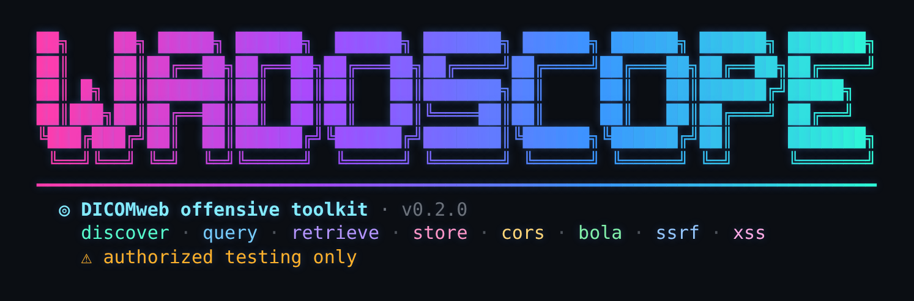

<p align="center">
  
</p>

<p align="center">
  <b>A DICOMweb offensive toolkit for authorized medical-imaging security testing.</b>
</p>

<p align="center">
  <code>discover · query · retrieve · store · cors · bola · ssrf · xss</code>
</p>

Hospitals increasingly expose imaging over **DICOMweb** - the HTTP/REST transport
(QIDO-RS, WADO-RS, STOW-RS) - and the big cloud imaging services (Google Cloud
Healthcare, Azure DICOM service, AWS HealthImaging) speak it natively. Classic
pentest tooling is DIMSE-only and can't reach any of that. `wadoscope` is the
DICOMweb counterpart: it enumerates, retrieves, injects, and runs the
**web-layer checks that only exist over HTTP** - unauthenticated endpoints,
CORS misconfiguration, and BOLA/IDOR on UIDs-in-URLs.

> For classic DIMSE (C-FIND / C-STORE / C-MOVE), use
> [`dicomrecon`](https://pypi.org/project/dicomrecon/) or nmap's `dicom-*` NSE
> scripts. `wadoscope` deliberately does **not** reimplement DIMSE - it owns the
> DICOMweb layer.

> ⚠️ **Authorized testing only.** Use this against systems you own or have
> written permission to test. Writes (STOW-RS) are disabled unless you pass
> `--unsafe`.

## Install

```bash
pip install -e .          # from a checkout
wadoscope --help
```

Requires Python 3.10+.

## Test lab (no real systems needed)

### Quickest start — no Docker needed

A single Python file serves a seeded DICOMweb target from pydicom's bundled
sample images (no network, no Docker) — ideal on Windows:

```bash
pip install pydicom
python docker/dicomweb_mock.py            # serves http://127.0.0.1:8042/dicom-web
```

Then, from another terminal:

```bash
python -m wadoscope discover http://127.0.0.1:8042
python -m wadoscope query    http://127.0.0.1:8042/dicom-web --level studies
python -m wadoscope xss      http://127.0.0.1:8042/dicom-web --unsafe
# start the mock with --reflect-cors, then:
python -m wadoscope cors     http://127.0.0.1:8042/dicom-web
```

`discover` reports the endpoint as **auth: NONE**, `query` lists the seeded PHI,
and `xss` flags the tags stored unescaped. For the auth contrast and the
per-object BOLA gateway, use the full Orthanc lab below.

### Full Orthanc lab (Docker)

Two Dockerized Orthanc targets, both intentionally insecure — **local use only**:

| Service | Port | Auth | Use |
|---------|------|------|-----|
| `orthanc-open` | 8042 | none | unauthenticated-access testing |
| `orthanc-auth` | 8043 | basic (`alice:alicepass`) | the unauth-vs-auth contrast |

```bash
cd docker
docker compose up -d
pip install pydicom                       # loader only

# seed the open lab, then the auth lab
python load_samples.py
python load_samples.py --url http://localhost:8043 --basic alice:alicepass
```

`load_samples.py` ends by printing ready-to-run `wadoscope` commands with the
real StudyInstanceUIDs filled in.

**The contrast to demo:** `discover http://localhost:8042` reports *auth: NONE*,
while `discover http://localhost:8043` reports *auth: enforced* — and `query`
against 8043 fails without `--basic` and succeeds with it.

### Per-object BOLA lab (authorization gateway)

Vanilla Orthanc auth is all-or-nothing, so for a *per-object* target the repo
ships a small DICOMweb authz gateway (`docker/authz_gateway.py`) that fronts the
open lab and scopes studies to bearer tokens — with a `vulnerable` and a
`secure` mode, giving a true before/after for BOLA:

```bash
cd docker
python load_samples.py --write-authz authz.json   # seeds + writes the token→study map
                                                   # (prints which study each token owns)

# BOLA PRESENT — authenticated but NOT object-scoped
python authz_gateway.py --mode vulnerable &
python -m wadoscope bola http://localhost:8044/dicom-web --bearer alice-token --study <BOB_STUDY_UID>
#   -> HIGH: a token reaches a study it doesn't own

# BOLA FIXED — per-object authz enforced
kill %1 ; python authz_gateway.py --mode secure &
python -m wadoscope bola http://localhost:8044/dicom-web --bearer alice-token --study <BOB_STUDY_UID>
#   -> denied (403)
```

This is the crisp before/after a talk wants: same request, same UID — reachable
when object authorization is missing, blocked when it's enforced.

### SSRF lab (retrieve-sink dereference)

`docker/ssrf_lab.py` mimics a rendering/retrieve backend that dereferences a
URL parameter server-side, with a `vulnerable` and a `secure` mode. `wadoscope
ssrf` stands up its own callback listener, sprays the candidate sink parameters,
and confirms SSRF only when the target actually calls back:

```bash
cd docker
python ssrf_lab.py --port 8045 --mode vulnerable &
python -m wadoscope ssrf http://127.0.0.1:8045/dicom-web --wait 4
#   -> HIGH: SSRF confirmed via 'url', 'uri', ... (out-of-band callback received)

kill %1 ; python ssrf_lab.py --port 8045 --mode secure &
python -m wadoscope ssrf http://127.0.0.1:8045/dicom-web --wait 4
#   -> no callback received — no SSRF confirmed
```

For a real engagement, point it at an external collaborator instead of the
local listener: `--callback https://<id>.oast.site` (you watch it for the
`<token>-<param>` hit).

### Stored-XSS lab (poisoned metadata → viewer)

`wadoscope xss` stores an instance whose free-text tags carry a payload, then
reads the metadata back and reports which tags the server returns **unsanitised**.
`docker/xss_viewer.html` is a deliberately-vulnerable mini-viewer that turns that
into a live pop — paste the metadata JSON and compare a naive `innerHTML` render
against the `textContent` fix:

```bash
python -m wadoscope xss http://localhost:8042/dicom-web --unsafe
#   -> HIGH: payload stored UNESCAPED in: StudyDescription, SeriesDescription, ...

# then, for the demo:
python -m wadoscope retrieve http://localhost:8042/dicom-web \
    --study <StudyUID> --mode metadata --format json   # paste into xss_viewer.html
```

> PatientName / ReferringPhysicianName are PN-VR, where `=` is a component
> separator - an `onerror=` payload is truncated there. For those tags pass a
> `=`-free payload, e.g. `--payload '<script>alert(document.domain)</script>'`.

## Quickstart

```bash
# 1. find endpoints + flag unauthenticated access
wadoscope discover http://localhost:8042

# 2. enumerate studies over QIDO-RS
wadoscope query http://localhost:8042/dicom-web --level studies

# 3. pull a study's metadata (read-only exfil) over WADO-RS
wadoscope retrieve http://localhost:8042/dicom-web --study <StudyUID> --mode metadata

# 4. web-layer checks
wadoscope cors http://localhost:8042/dicom-web
wadoscope bola http://localhost:8042/dicom-web --study <StudyUID>
wadoscope ssrf http://localhost:8042/dicom-web            # out-of-band, read-only

# 5. injection over STOW-RS (writes — explicit opt-in)
wadoscope store http://localhost:8042/dicom-web ./sample.dcm --unsafe
wadoscope xss   http://localhost:8042/dicom-web --unsafe  # stored XSS in metadata
```

Auth: `--basic USER:PASS` or `--bearer TOKEN` (OAuth2 / SMART-on-FHIR). `-k`
skips TLS verification.

## Commands

| Command    | DICOMweb service / check | Purpose |
|------------|--------------------------|---------|
| `discover` | path probe + fingerprint | find endpoints; ID server/cloud; detect unauth `/studies` |
| `query`    | QIDO-RS                  | enumerate studies / series / instances (PHI exposure) |
| `retrieve` | WADO-RS                  | pull metadata (read-only) or a full study |
| `store`    | STOW-RS                  | inject instances (write; `--unsafe` required) |
| `cors`     | web-layer                | cross-origin PHI exposure via CORS misconfig |
| `bola`     | web-layer                | per-object authz (IDOR on StudyInstanceUID) |
| `ssrf`     | web-layer                | out-of-band probe of retrieve/URL sinks (read-only) |
| `xss`      | web-layer                | stored XSS in DICOM metadata (write; `--unsafe` required) |

## Safety

Every state-changing request passes a single safe-mode gate (`DicomWebClient`).
With safe mode on (the default), STOW-RS is refused. This keeps accidental
writes off production systems and makes read-only assessment the default.

## Status

Alpha (0.2). Shipped: discover / query / retrieve / store, and the web-layer
checks cors, bola, **ssrf** (out-of-band), and **xss** (stored, in metadata).
Roadmap: WADO multipart → per-instance `.dcm` splitting, DICOMweb request
fuzzing, a server-fingerprint→CVE database, and a cloud-DICOMweb profile
(Google/Azure/AWS auth + endpoint quirks).

## License

MIT © Ananthapadmanabhan A
